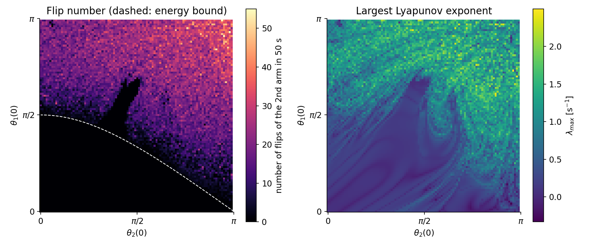
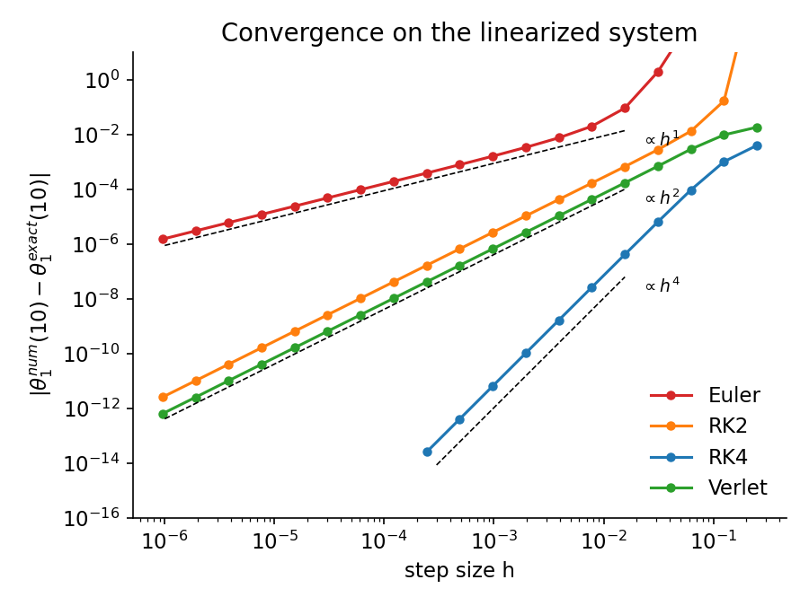
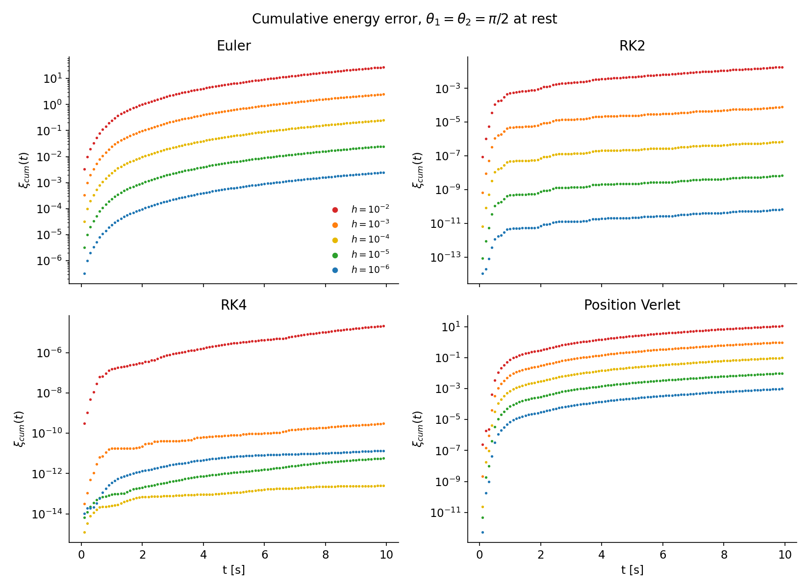
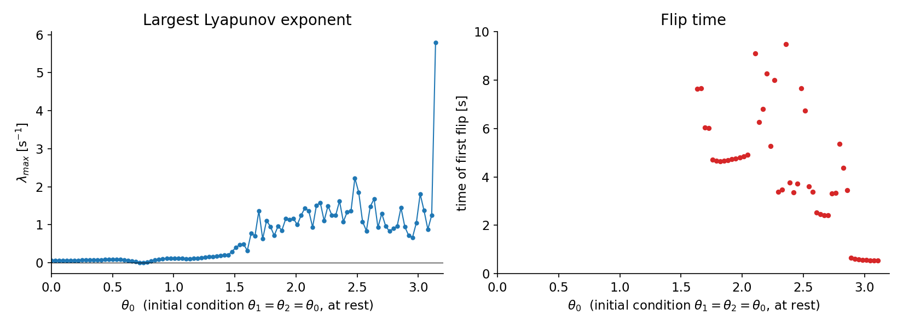

# Chaos in the double pendulum

A double pendulum simulated from scratch in C++: four integrators written by hand and validated
against conservation laws and an exact solution, then used to map where in the space of initial
conditions the motion becomes chaotic.

*Course project for Numerical Algorithms, MSc in Physics of Complex Systems, University of Turin.*



*Both arms start at rest from angles (θ₁, θ₂). **Left:** how many times the second arm flips over
in 50 s. The dashed line is the energy bound 2 cos θ₁ + cos θ₂ = 1: below it the pendulum does not
have enough energy to flip, and the simulation correctly never does. **Right:** largest Lyapunov
exponent. The regular region at low energy (λ ≈ 0) gives way to chaos as the initial angles grow,
with filaments of regular motion inside the chaotic sea.*

## What is in the project

| | |
|---|---|
| **Model** | Point masses m₁ = m₂ = 1, rods L₁ = L₂ = 1, g = 9.81; full nonlinear equations of motion and the small-angle linearization ([`src/system.cpp`](src/system.cpp)) |
| **Integrators** | Euler, RK2 (midpoint), RK4, position Verlet ([`src/integrators.cpp`](src/integrators.cpp)) |
| **Validation** | energy conservation vs time step; global error against the exact normal-mode solution of the linearized system |
| **Chaos** | largest Lyapunov exponent with Benettin's renormalisation algorithm, finite-time Lyapunov exponent, flip time and number of flips ([`src/lyapunov.cpp`](src/lyapunov.cpp), [`src/flip_time.cpp`](src/flip_time.cpp)) |

## Results

**1. The integrators converge with their theoretical order.** On the linearized system θ₁(t) is known
exactly, so the global error at t = 10 s can be measured directly: Euler is first order, RK2 and
Verlet second order, RK4 fourth order down to machine precision.



**2. Energy conservation tells a different story on the nonlinear system.** RK4 keeps the relative
energy error below 10⁻¹¹ at Δt = 10⁻³. Position Verlet, which is second order on the linear problem,
shows an energy error that scales only as Δt: for the double pendulum the accelerations depend
on the velocities, so the scheme loses the symplectic structure that usually makes Verlet good at
conserving energy. RK4 with Δt = 10⁻⁴ was therefore used for all the chaos indicators.



**3. Onset of chaos.** Along the diagonal θ₁ = θ₂ = θ the Lyapunov exponent stays close to zero up to
θ ≈ π/2 and then becomes clearly positive. The single-run FTLE agrees with Benettin's estimate in
the chaotic region but overestimates it in the regular one, where the separation has not yet
settled on its asymptotic growth. The last point (θ = π, both arms upright) is the unstable
equilibrium.



## Repository structure

```
├── include/              headers
├── src/
│   ├── main.cpp          experiment selection (energy, convergence, lyapunov, grids)
│   ├── system.cpp        equations of motion, exact solution of the linearized system
│   ├── integrators.cpp   Euler, RK2, RK4, position Verlet
│   ├── simulate.cpp      integration loop with output callbacks, grids of initial conditions
│   ├── energy.cpp        mechanical energy and relative error
│   ├── lyapunov.cpp      Benettin's algorithm and FTLE
│   └── flip_time.cpp     flip time and number of flips
├── scripts/
│   └── plot_results.py   figures from the output tables
├── figures/              figures used in this README
└── Makefile
```

## Reproducibility

- **Requirements:** a C++17 compiler with OpenMP (tested with g++ 13); Python 3 with NumPy and Matplotlib for the figures.
- **Run:** `make`, then `./double_pendulum all` (or one of `energy`, `convergence`, `lyapunov`, `grids`)
  and `python scripts/plot_results.py`. Everything runs in a few minutes on a laptop.
- **Data:** none needed; the simulations write their output tables to `data/`.

## Author

Vittorio Bargero, MSc in Physics of Complex Systems, University of Turin.
